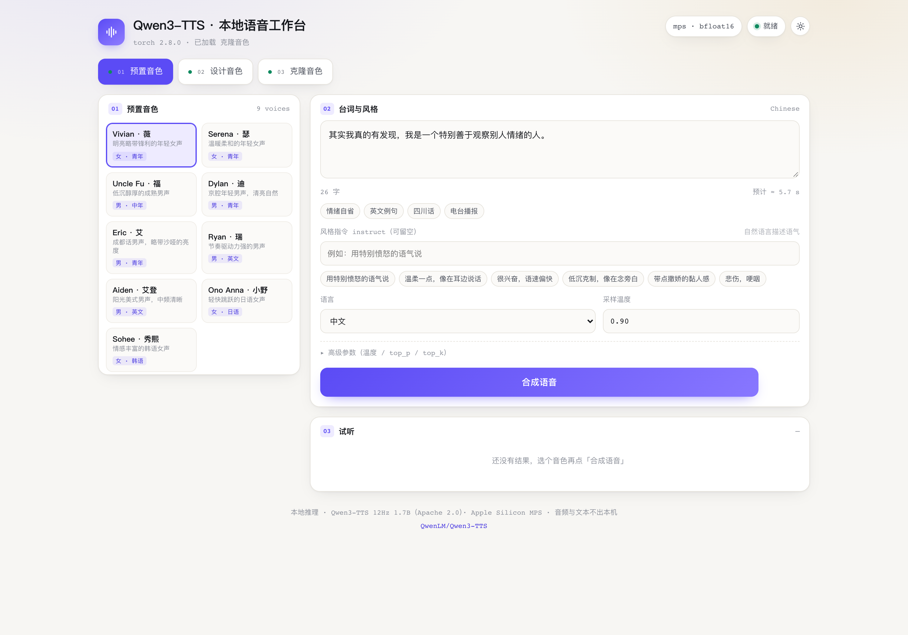

# Qwen3-TTS 本地语音工作台

在 Apple Silicon 上本地跑 **Qwen3-TTS**（Apache 2.0）的完整工作台：预置音色、文字设计音色、参考音克隆，三条链路共用一套 FastAPI 后端和单页 UI。音频与文本全程不出本机。

> 起因是报告《AI 数字人全流程》第三章「造声音」——这里把它落成了可运行的代码。



## 三种模式

| 模式 | 模型 | 做什么 | 关键参数 |
|---|---|---|---|
| **01 预置音色** | `1.7B-CustomVoice` | 9 个内置音色，用自然语言改语气情绪 | `speaker` + `instruct` |
| **02 设计音色** | `1.7B-VoiceDesign` | 用文字描述凭空造一个声音，一次出多档候选 | `instruct` + `n` |
| **03 克隆音色** | `1.7B-Base` | 3–15 秒参考音锁定音色，念任意台词 | `ref_audio` + `ref_text` |

三个模型架构相同、各约 3.9 GB。服务按需加载，同一时刻内存里只留一个（`QWEN_TTS_KEEP` 可调），所以 48 GB 机器能跑完三个而不用手动切换。

## 快速开始

```bash
./setup.sh    # 建 venv、装依赖、拉上游 qwen-tts 源码（约 3 分钟）
./run.sh      # → http://127.0.0.1:8808
```

`run.sh` 会检查三个模型，缺哪个从 ModelScope 补哪个（直连约 20 MB/s，断点续传 + sha256 清单）。首次启动加载约 15 秒，右上角变绿「就绪」即可用。

想后台常驻：

```bash
nohup ./run.sh > server.log 2>&1 &
```

## 实测（M4 Pro · 48 GB · macOS 26.5.1）

| 链路 | 精度 | 音频时长 | 生成耗时 | RTF |
|---|---|---|---|---|
| 预置音色（热态） | mps + bfloat16 | 6.2 s | 13–15 s | **2.2–2.5×** |
| 预置音色（热态） | mps + float32 | 6.2 s | 24.6 s | 3.97× |
| 克隆音色 | mps + bfloat16 | 3.4 s | 21 s（含首次加载） | — |

- 采样率 24 kHz，输出 16-bit PCM WAV
- 首次生成比热态慢 30–50%（算子图编译），属正常
- 质检口径沿用报告：faster-whisper 回听，克隆与预置链路示例句**逐字一致**（字面相似度 1.000）
- MPS 上 bfloat16 比 float32 快约 1.7×，输出质量无损，故设为默认

## HTTP 接口

非流式：整句合成完才返回，长句等待 ≈ 字数 ÷ 4.6 × 2.4 秒。

```
GET  /api/info                 设备、精度、三模式可用状态
GET  /api/health               存活检查
POST /api/tts                  {text, speaker, language, instruct}       → audio/wav
POST /api/design               {text, instruct, language, n}             → {candidates:[{id,dur,audio}]}
POST /api/clone                {text, profile, language, ref_text}       → audio/wav
POST /api/upload_ref           上传参考音，返回 base64
GET  /api/profiles             音色卡列表
POST /api/profiles             保存音色卡 {name, audio_b64, ref_text, instruct}
```

音频响应用自定义头回传指标：`X-Gen-Seconds` / `X-Audio-Seconds` / `X-Rtf` / `X-Sample-Rate`。

```bash
curl -X POST http://127.0.0.1:8808/api/tts \
  -H 'Content-Type: application/json' \
  -d '{"text":"这是一段本地合成的示例语音。","speaker":"Serena","language":"Chinese","instruct":"温柔一点"}' \
  -o out.wav
```

## 目录

```
qwen3tts-lab/
├── run.sh              # 启动（自动补下缺失模型）
├── setup.sh            # 从零装环境
├── server.py           # FastAPI 服务：三模型按需加载、生成串行锁、音色卡存储
├── web/index.html      # 单页 UI：三 Tab、明暗主题、波形播放器、候选对比、RTF 统计
├── download_model.py   # ModelScope 下载器（断点续传 + sha256 清单）
├── tts_test.py         # 单次推理冒烟测试
├── tts_bench.py        # 精度/速度基准
└── models/             # 权重（git 忽略，约 12 GB）
```

## 环境变量

| 变量 | 默认 | 说明 |
|---|---|---|
| `QWEN_TTS_PORT` | 8808 | 服务端口 |
| `QWEN_TTS_DEVICE` | mps（可用时） | 强制 `cpu` / `mps` |
| `QWEN_TTS_DTYPE` | mps→bfloat16, cpu→float32 | 精度 |
| `QWEN_TTS_KEEP` | 1 | 同时驻留内存的模型数（2 可免去来回加载，代价是 +4 GB 内存） |

## 已知边界

- **非流式**：没有逐句推送，长文本请自行切句
- **设计模式音色不稳定**：换一句台词重新采样，音色会有漂移；要固定就用「设计 → 存音色卡 → 克隆」这条闭环
- **起音噪声**：预置音色偶发在句首多出半个音节（ASR 会听成「喂」之类），克隆链路未观察到
- `sox` 命令行工具未装时 pysox 会在导入时打印警告，12Hz 链路不受影响（只有 25Hz tokenizer 用到）
- 0.6B 版本体积减半（约 2.5 GB），但**不支持 instruct**，也更容易读错多音字

## 许可

代码 MIT。模型权重为 Qwen 官方 Apache 2.0，使用时请遵守 [Qwen3-TTS](https://github.com/QwenLM/Qwen3-TTS) 的条款。
